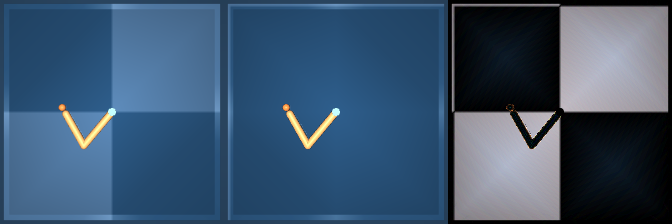
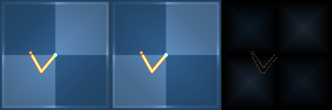

# LeWorldModel on one AMD Radeon Pro W7900

上游是 [lucas-maes/le-wm](https://github.com/lucas-maes/le-wm)，`main` @ `8edfeb33`。论文是 [arXiv:2603.19312](https://arxiv.org/abs/2603.19312)（NeurIPS 2026），项目页 [le-wm.github.io](https://le-wm.github.io/)。上游说明原样保留在 [`UPSTREAM_README.md`](UPSTREAM_README.md)。

这次在一张 AMD Radeon Pro W7900 上跑了上游 README 的两条路径：

```bash
python eval.py --config-name=pusht.yaml policy=quentinll/lewm-pusht   # 发布权重的规划评测，四个环境
python train.py data=tworoom                                           # 从头训练，按论文的 10 个 epoch
```

- **发布的权重。** 四个环境各评 50 回合：Two-Room 86%（论文 87%，三个种子平均 89%）、Push-T 94%（96%）、OGBench-Cube 68%（74%）、Reacher 三个种子平均 79%（86%）。Reacher 一开始只有 66%，原因是新版 MuJoCo 画的地板和数据集不一样，钉回 3.11 后恢复。
- **从头训练。** Two-Room 按论文附录训 10 个 epoch，51,380 步，用时 4 小时 41 分。训出来的权重三个种子 92% / 94% / 94%，平均 93%；同样三个种子下发布的权重平均 89%。
- **规划耗时。** 一次规划（300 个候选 × 30 轮）在四个环境里都是 0.79–0.81 秒。

le-wm 的代码一行没改。要处理的是依赖版本、数据和权重的摆放，以及训练时的矩阵乘法选核。

## 许可

le-wm 是 MIT（`LICENSE`，Lucas Maes）。依赖的 stable-worldmodel 和 stable-pretraining 从 PyPI 安装，不在这个仓库里。权重和数据集在 Hugging Face 的 [quentinll/lewm](https://huggingface.co/collections/quentinll/lewm) 合集里，由 `radeon/download.sh` 下载，这里不分发。

## 改了什么

| 文件 | 改了什么 |
| --- | --- |
| `README.md` | 换成这份说明，上游的改名为 `UPSTREAM_README.md`，内容不变 |
| `radeon/` | 容器、依赖、数据、评测、训练和检查脚本，见下文 |
| `results/` | 这次运行的日志和结果 |

第一个提交 `cd1543f` 是上游 `8edfeb33` 的原样树，`git diff cd1543f` 看全部改动。

移植里真正要处理的四件事：

- **依赖。** 上游 README 只装 `stable-worldmodel[train,env]`。PyPI 上最新的 0.1.1 把 `eval.py` 用的 HDF5 读取器挪进了 `format` 附加项，不装就没有 `swm.data.HDF5Dataset`。transformers 5 改了 ViT 的参数名（`encoder.encoder.layer.N.attention.attention.query` 变成 `encoder.layers.N.attention.q_proj`），发布的权重载不进去，要 `transformers<5`；它又要 `huggingface-hub<1`，进而要 `datasets<5`。
- **MuJoCo。** 不钉版本时，`dm_control` 1.0.52 会拉进 2026-11-11 发布的 MuJoCo 4.0.1。从 MuJoCo 3.12（`dm_control` 1.0.45）起，DMC Reacher 的地板棋盘格画出来和数据集里的帧不一样，见下文。钉在 `mujoco==3.11.0`、`dm_control==1.0.44`。
- **数据和权重的位置。** `load_pretrained('quentinll/lewm-<env>')` 写死从 huggingface.co 下载，除非 `$STABLEWM_HOME/checkpoints/models--quentinll--lewm-<env>/` 已经存在，`download.sh` 用认 `HF_ENDPOINT` 的 `hf` 命令把它填好。0.1.1 在 `$STABLEWM_HOME/datasets/` 下找数据集，上游 README 写的是 `$STABLEWM_HOME` 根目录。评测配置要的 `dmc/reacher_random` 和 `ogbench/cube_single_expert` 与压缩包里的文件名不同，`download.sh` 建好链接和目录。Push-T 的训练配置写的是 `.lance` 表，Hugging Face 上发的是 `.h5`，命令行改 `data.dataset.name`。
- **训练吞吐。** `PYTORCH_TUNABLEOP_ENABLED=1` 让 PyTorch 在这张卡上实测每种矩阵形状的候选核再选，一步训练从 358 ms 降到 279 ms，见下文。

## 环境

- 镜像：`rocm/pytorch:rocm7.14_ubuntu24.04_py3.12_pytorch_release_2.11.0`，PyTorch `2.11.0+rocm7.14.0`，HIP 7.14.60850。
- GPU：一张 AMD Radeon Pro W7900D（gfx1100，48 GB）。容器只挂 `/dev/kfd` 和一个渲染节点，容器内 `HIP_VISIBLE_DEVICES=0`、`ROCR_VISIBLE_DEVICES=0`。
- 主要依赖：stable-worldmodel 0.1.1、stable-pretraining 0.1.8、transformers 4.57.6、datasets 4.8.5、huggingface-hub 0.36.2、Lightning 2.6.6、MuJoCo 3.11.0、dm_control 1.0.44、ogbench 1.2.2。[`results/pip_freeze.txt`](results/pip_freeze.txt) 和 [`results/install.log`](results/install.log) 来自在空白容器里重跑一遍 `install.sh`。
- 渲染：Push-T 和 Two-Room 用 pygame/pymunk 在 CPU 上画。Reacher 和 Cube 用 MuJoCo，`eval.py` 设了 `MUJOCO_GL=egl`，由 Mesa 25.2.8 的 radeonsi 驱动在 W7900 上画。

## 复现

**1. 代码和容器。** 工作目录挂到 `/workspace`，仓库放在 `$WORK/src`：

```bash
git clone https://github.com/charyang-ai/le-wm.git $WORK/src
bash $WORK/src/radeon/start_container.sh $WORK /dev/dri/renderD129
docker exec radeon-le-wm bash /workspace/src/radeon/install.sh
```

`install.sh` 还认 `PIP_INDEX_URL` 和 `APT_MIRROR`（例如 `http://mirrors.aliyun.com/ubuntu/`）；`start_container.sh` 认 `HF_ENDPOINT`。

**2. 权重和数据。** 四个环境的压缩包一共 86 GB，解开约 260 GB：

```bash
docker exec radeon-le-wm bash /workspace/src/radeon/download.sh tworooms pusht reacher cube
```

**3. 评测。** 每个环境先跑发布的权重，再跑随机策略；`SEEDS` 可以换起点的种子：

```bash
docker exec radeon-le-wm bash /workspace/src/radeon/eval_all.sh tworoom pusht reacher cube
docker exec -e SEEDS="1 2" radeon-le-wm bash /workspace/src/radeon/eval_all.sh tworoom reacher
docker exec radeon-le-wm python /workspace/src/radeon/summarize_eval.py /workspace/results/eval
```

**4. 训练。** 按论文附录训 10 个 epoch（仓库默认是 100），训完用同一个评测配置评最后一个检查点：

```bash
docker exec radeon-le-wm bash /workspace/src/radeon/train.sh tworoom lewm_tworoom_w7900
```

**5. 检查。**

```bash
docker exec -w /workspace/src radeon-le-wm python radeon/render_check.py reacher 8      # 环境画面和数据集帧逐像素比
docker exec -w /workspace/src radeon-le-wm python radeon/plan_timing.py --config-name=pusht.yaml policy=quentinll/lewm-pusht
docker exec -w /workspace/src radeon-le-wm python radeon/bench_train_step.py 20 128   # 合成数据上的训练步耗时和热点
```

## 验证

### 发布权重的规划成功率

`eval.py` 的默认设置：每个环境按种子从数据集里抽 50 个起点，目标是同一条轨迹 25 步之后的状态，预算 50 步；CEM 每次规划 300 个候选、30 轮、取前 30，规划 5 个动作块，每块 5 帧。日志在 [`results/eval/`](results/eval/)，汇总在 [`results/eval_summary.md`](results/eval_summary.md)。

| 环境 | LeWM（W7900） | 论文 | 随机策略（W7900） | 论文的随机策略 |
| --- | --- | --- | --- | --- |
| Two-Room（种子 42 / 1 / 2） | 86% / 96% / 84%，平均 89% | 87% | 18% / 30% / 32% | 0% |
| Push-T | 94% | 96% | 6% | 2% |
| OGBench-Cube | 68% | 74% | 48% | 48% |
| Reacher（种子 42 / 1 / 2） | 76% / 82% / 80%，平均 79% | 86% | 4% | 10% |

50 回合时，成功率 80% 左右的标准差约 5.7 个百分点，同一份权重换个种子能差 12 个点（Two-Room 的 84% 和 96%）。Two-Room 三个种子平均比论文高 2 个点，Push-T 低 2 个点；Cube 差 3 个回合，约一个标准差，随机策略的 48% 和论文相同；Reacher 三个种子共 150 回合，79.3% ± 3.3%，比论文低约两个标准差。Two-Room 的随机策略这里是 18–32%，论文是 0%，用的是 stable-worldmodel 自带的 `RandomPolicy`，起点和目标与 LeWM 的评测相同。

### Reacher：新版 MuJoCo 画的地板不一样

Reacher 第一次评测只有 66%。`eval.py` 的目标图取自数据集，规划开始时的当前图也取自数据集，之后每一步的当前图是环境现画的。如果环境画的和数据集里的不一样，第二次规划就是拿现画的图去追数据集里的目标图。

`radeon/render_check.py` 把数据集里的状态（`qpos`、`qvel`）写回环境再画一张，和数据集里同一行的帧逐像素比。同样 8 个随机行，每组版本装在单独的目录里（`pip install --no-deps --target`），结果在 [`results/render_check/`](results/render_check/)：

| MuJoCo / dm_control | 发布时间 | 平均绝对差（0–255） | 差超过 8 的像素 |
| --- | --- | --- | --- |
| 3.5.0 / 1.0.37、3.6.0 / 1.0.38；3.7.0、3.8.0、3.9.0 配 1.0.38；3.10.0 / 1.0.43、3.11.0 / 1.0.44 | 2026-02 到 07 | 2.58 | 2.7% |
| 3.12.0 / 1.0.45、3.13.0 / 1.0.46、3.14.0 / 1.0.47、3.16.0 / 1.0.49、3.17.0 / 1.0.50、4.0.1 / 1.0.52 | 2026-08 到 11 | 19.99 | 47.6% |
| 4.0.1 / 1.0.52，OSMesa（CPU 软件渲染） | 2026-11 | 20.00 | 47.6% |





机械臂的位置完全一致，差在地板：3.12 以后的版本只画出一大块深蓝，数据集里是四格棋盘。GPU 上的 EGL 和 CPU 上的 OSMesa 结果相同，问题不在 Radeon 的驱动。钉到 3.11.0 以后，Reacher 从 66% 回到 76%（种子 42）。换成数据集那个年代的 MuJoCo 3.5.0 物理，成功率还是 76%，剩下的差距不在物理版本上。Cube 在 3.11.0 下的平均差是 0.29，差超过 8 的像素 0.8%（[`cube_82356.png`](results/render_check/cube_82356.png)）。

### 规划耗时

`radeon/plan_timing.py` 给 `CEMSolver.solve` 套上计时，前后各同步一次 GPU，记下每次规划了几个环境。四个环境各跑一遍 `eval.py`，卡上没有别的任务，日志在 [`results/plan_timing/`](results/plan_timing/)：

| 环境 | 第一次 solve | 每个环境 | 第二次 solve | 每个环境 |
| --- | --- | --- | --- | --- |
| Two-Room | 50 个环境，40.54 s | 0.811 s | 8 个环境，6.45 s | 0.806 s |
| Push-T | 50 个环境，40.64 s | 0.813 s | 11 个环境，8.78 s | 0.798 s |
| Reacher | 50 个环境，40.49 s | 0.810 s | 31 个环境，24.66 s | 0.796 s |
| Cube | 50 个环境，40.65 s | 0.813 s | 16 个环境，12.71 s | 0.794 s |

一次规划在四个环境里都是 0.79–0.81 秒，和论文说的 “固定规划设置下耗时与环境无关” 一致。`eval.py` 打印的 “CEM solve time” 是一次 `solve` 的总时间：`batch_size=1` 时它逐个环境串行规划，第一次覆盖全部 50 个环境，所以要 40 秒左右；第二次只规划还没结束的环境。两次的单环境耗时只差 0.01 秒左右，首次调用的额外开销不到 1 秒。

论文的 0.98 秒是在 NVIDIA L40S 上用作者当时的代码测的。stable-worldmodel 0.1.1 的 `LeWM.get_cost` 在 30 轮之间缓存当前帧和目标帧的编码；自训练的权重载入的是 le-wm 自己的 `jepa.JEPA`，每轮都重新编码这两帧，同一张卡上第一次规划要 55 秒，约 1.1 秒一个环境。两边不是同一份代码，0.98 和 0.8 只能看量级。

### 训练吞吐

`radeon/bench_train_step.py` 在合成数据上跑一步完整的训练（batch 128，每个样本 4 帧 224×224，bf16 自动混合精度，SIGReg，AdamW），不含数据读取，卡上没有别的任务：

| 设置 | 每步 | 每秒步数 |
| --- | --- | --- |
| 默认 | 358 ms | 2.79 |
| `PYTORCH_TUNABLEOP_ENABLED=1` | 279 ms | 3.58 |

默认设置下，剖析的 3 步一共 1.05 秒 GPU 时间，一半是矩阵乘法：反向 403 ms、前向 119 ms。耗时最多的单个核是 32×32 分块的 Tensile bf16 GEMM（`Cijk_..._MT32x32x32_MI16x16x16x1`，占 17%）。TunableOp 对每种矩阵形状实测 rocBLAS 和 hipBLASLt 的候选核：反向里算权重梯度的那几个矩阵乘法（归约维 131,584，即 512 张图 × 257 个 token）都换成了 hipBLASLt 的核，其余多数选了 rocBLAS，个别保持默认。反向矩阵乘法降到 186 ms，3 步的 GPU 时间降到 0.81 秒，剩下的大头是 flash attention 的反向（116 ms）、类型转换（70 ms）和 LayerNorm 的反向（58 ms）。选核结果存在 [`results/tunableop/`](results/tunableop/)，第二次运行直接读。

真正训练时（24 个进程读数据），Two-Room 每个 epoch 都稳定在每秒 3.1–3.2 步。第一次没开 TunableOp 的 Push-T 训练是每秒 1.9–2.0 步，跑了 350 步后停掉（[`results/train/lewm_pusht_w7900.log`](results/train/lewm_pusht_w7900.log)）。

### 从头训练 Two-Room

`radeon/train.sh tworoom`：配置全用仓库默认（batch 128、bf16、AdamW 学习率 5e-5、SIGReg 权重 0.09、预测器看 3 帧，和发布的 Two-Room 权重的 `config.json` 一致），只把 epoch 改成论文附录的 10 个。73 万个片段的九成用来训练，每个 epoch 5,138 步，一共 51,380 步，2026-11-20 07:51 到 12:32（UTC），4 小时 41 分，含每个 epoch 的验证和 TunableOp 的首次选核。日志在 [`results/train/lewm_tworoom_w7900.log`](results/train/lewm_tworoom_w7900.log)。

每个 epoch 结束时在留出的一成数据上的验证损失（总损失 = 预测损失 + 0.09 × SIGReg）：

| epoch | 1 | 2 | 3 | 4 | 5 | 6 | 7 | 8 | 9 | 10 |
| --- | --- | --- | --- | --- | --- | --- | --- | --- | --- | --- |
| 总损失 | 8.06 | 5.05 | 2.21 | 0.502 | 0.483 | 0.256 | 0.227 | 0.175 | 0.161 | 0.157 |
| 预测损失 | 1.54 | 1.02 | 0.379 | 0.108 | 0.086 | 0.044 | 0.034 | 0.013 | 0.0079 | 0.0067 |
| SIGReg | 72.4 | 44.8 | 20.3 | 4.38 | 4.42 | 2.35 | 2.14 | 1.80 | 1.70 | 1.67 |

用第 10 个 epoch 的权重，按同一个评测配置评三个种子：

| 种子 | 训出来的权重 | 发布的权重 | 随机策略 |
| --- | --- | --- | --- |
| 42 | 92% | 86% | 18% |
| 1 | 94% | 96% | 30% |
| 2 | 94% | 84% | 32% |
| 平均（150 回合） | 93.3% | 88.7% | 26.7% |

论文是 87%。训出来的权重比发布的高 4.7 个百分点，约 1.4 个标准差，能说的是：在这张卡上从头训出来的权重不比作者发布的差。[`results/videos/`](results/videos/) 里是每个环境前两个回合的视频，`tworoom_trained` 是训出来的权重。

### 没有验证的

- Push-T、Reacher、Cube 的从头训练没有跑。Push-T 一个 epoch 13,933 步，按每秒 3.2 步，10 个 epoch 约 12 小时。
- Reacher 钉回 MuJoCo 3.11 之后三个种子平均 79%，比论文的 86% 低约两个标准差，原因没有找到。
- 论文里和 DINO-WM、PLDM 等基线的对比、物理量探测和 “违背预期” 实验不在这次运行的范围内。
- 论文的 0.98 秒规划时间是在 NVIDIA L40S 上测的，这里没有同一张卡做对照。
